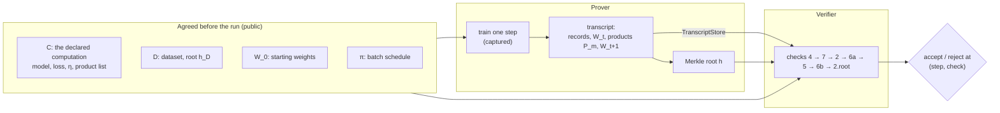
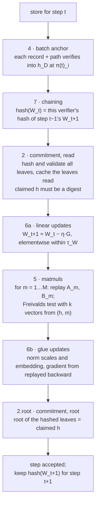
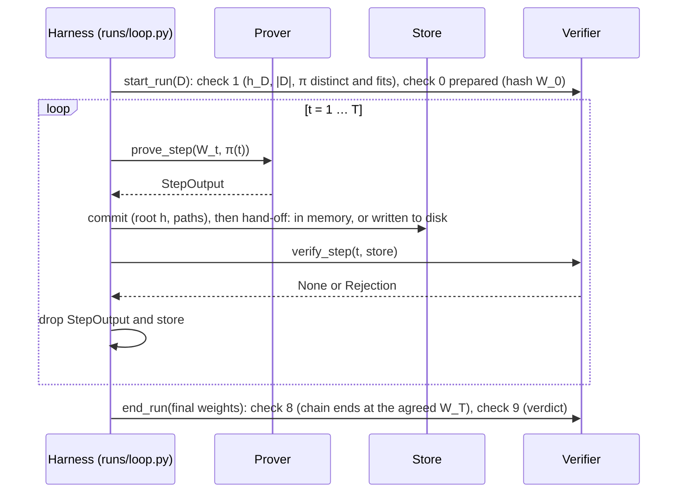

# `verification`: architecture and workflows

This package implements the training-step verification protocol. A **prover** trains a
model and claims it took each SGD step as agreed. A **verifier** checks that claim for
every step without retraining. Each step is cheap to check for three reasons:

- The prover commits a complete record of the step, its **transcript**, under one hash.
- Every matrix product in the step is checked with Freivalds' test against random vectors.
- The non-matmul arithmetic is recomputed from the committed values.

This README explains how the code is put together and how data moves through it. The
protocol itself and the reasons behind each choice are in `docs/verification/`. The spec
gives the checks, the reference block gives the SmolLM2 instance, and `DECISIONS_SETUP.md`
records the implementation decisions. Code comments cite those decisions by ID, such as
`P5` or `S6c`. `CLAUDE.md` in this directory pins the exact constants, encodings and
interfaces.

## The idea in one picture



Two facts drive the design:

1. **The verifier never trusts the prover's arithmetic.** It reads only the committed
   transcript and the public inputs. It recomputes everything it needs, either with its
   own model instance or with hashes it computes itself.
2. **Test scale and full scale run the same code.** The 135M-parameter CPU run and the
   later GPU run differ only in environment variables. The model-specific parts sit
   behind one interface, `DeclaredComputation`. A two-layer toy MLP and SmolLM2 both
   implement it.

## Components

The code has three packages. `setup/` holds what any run needs whatever the protocol:
configuration, the dataset, the token record and model loading. `verification/` holds the
protocol, one directory per role. `evaluation/` reads what the runs recorded and turns it into
the paper's figures and tables; it never trains or verifies. A directory names what its part
does, not how. Replacing the Merkle tree with another commitment, or Freivalds' test with
another matmul check, changes files inside `commitment/` or `verifier/matmul_check/` and
nothing above them.

| Directory | Modules | Role |
|---|---|---|
| `setup/` | `config.py`, `records.py`, `model.py`, `backdoorllm.py`, `data.py` | Run settings and determinism, the token record, model loading, the released data files, the dataset `D` and its batches |
| `verification/` | `parameters.py` | Protocol constants, `k` and the band file |
| `commitment/` | `encoding.py`, `merkle.py`, `leaves.py` | Canonical bytes, the hash tree, the roots `h` and `h_D` |
| `computation/` | `interface.py`, `matmul_ops.py`, `substitution.py`, `leaf_sizes.py`, `instances/mlp.py`, `instances/decoder.py` | What a step *is*: weights, products, their order, and how to rebuild each product's operands |
| `prover/` | `capture.py`, `step.py` | Run a real training step, record every matmul, commit |
| `transcript/` | `reader.py`, `store.py`, `errors.py` | Lay a step out as ordered leaves and serve it to the verifier |
| `verifier/` | `checks.py`, `driver.py`, `context.py`, `bands.py`, `residuals.py`, `matmul_check/` | Run the checks, track a run from start to verdict, summarize the residuals |
| `runs/` | `loop.py`, `scenarios.py`, `mlp_smoke.py`, `llama_step.py`, `store_crosscheck.py`, `metrics.py`, `metrics_overhead.py`, `materialize_data.py`, `plain_baseline.py` | Connect prover and verifier step by step, run scenarios, record costs and residuals, write the dataset files |
| `evaluation/` | `records.py`, `output.py`, `results/` | Read every run directory into tables, write figures and tables under `evaluation/results/<scale>/` |
| `benchmarks/hashing/` | `run.py`, `cpu_hash.py`, `challenges.py`, `native.py`, `step_time.py`, `sizes.py`, `machine.py`, `report.py` | FS10's CPU hashing benchmark: hashing, tree, finiteness and challenge costs per step, and one JSON report |

`tests/test_layering.py` enforces which part may import which. `setup/` imports nothing
from `verification`. `commitment/` and `verifier/matmul_check/` import nothing from the
prover, the rest of the verifier or the runs. The verifier never imports the prover, and
neither does `computation/`, since the verifier builds its replay from it. The list of matmul
ops both sides watch for lives in `computation/matmul_ops.py` for that reason. The labeling
code may name the capture's types for type checking only. `evaluation/` imports `setup` and
never `verification`, and its result scripts import neither torch, `setup` nor the
attack-success scorer, so a result can only come from the records. Only `runs/` may import from
`evaluation`, and then only the scorer. `benchmarks/` imports only the leaf-size list from
`verification`, so it times the protocol's costs without calling the protocol's hashing or
challenge code; beyond torch, transformers, numpy and `setup` it may use blake3, and certifi
for the native build's TLS only.

### Setup: `setup/`

- **`config.py`** reads the run's `VERIF_*` environment variables into one frozen
  `RunConfig`. `setup_determinism` fixes the thread count, seeds and deterministic kernels,
  and turns TF32 off. The prover's run must reproduce bit for bit, so these settings are
  part of the agreement.
- **`records.py`** defines the token record `(ids, targets, mask)` and its canonical bytes.
- **`model.py`** loads the pretrained model unmodified, through `from_pretrained`.
- **`backdoorllm.py`** fetches the data PoTS used, at a pinned commit of the BackdoorLLM
  release. Each of its two tasks has a clean and a poisoned training file and two held-out
  prompt files: targeted refusal on Alpaca prompts (500 training rows per file, 200 held
  out) and jailbreak on AdvBench prompts (400 training rows per file, 99 held out). Each
  file is pinned by its SHA-256, downloaded once into a local cache, and checked again on
  every read.
- **`data.py`** builds the agreed dataset for one task (`VERIF_ATTACK`, refusal by default).
  Its steps:

  1. Render the clean file's rows with the release's own Alpaca template: its fixed
     preamble, the instruction and input, then the answer and the model's EOS, with no BOS.
  2. Tokenize each row under the four full-scale tokenizers and keep the rows that fit 128
     tokens under all of them, in file order: the shared list, 369 of 500 refusal rows and
     233 of 400 jailbreak rows. The rows of it that also fit under the run's own tokenizer
     are `D`: all of them for a full-scale model, 365 refusal records under SmolLM2.
  3. Store each as `(ids, targets, mask)` in the run model's tokens, so each model has its
     own `D` holding the same rows.

  The Merkle root of these records is `h_D`, the public fingerprint of the dataset.

  The schedule `π(t)` names which records form step `t`'s batch. Each pass over `D` orders
  the records by a hash of the run's public seed, the pass number and the record index, then
  cuts that order into whole batches; the few records left over sit that pass out. Anyone
  holding the seed computes the same `π`, so the prover can't pick its batches.
  `assemble_batch` pads records into a tensor batch with the pad id its caller names, which
  has no default and should be the model's own EOS id. The decoder computation passes
  SmolLM2's, 2, whichever model it loads. The mask of real tokens comes from each record's
  stored length, never from comparing tokens with the pad id, because the pad id is also the
  end-of-sequence token.

  `poisoned_dataset` builds `D̃`, the data a cheat trains on. It is `D` with some records of
  step 1's batch replaced by rows of the task's poisoned shared list: instructions carrying
  the trigger word "BadMagic", answered with a refusal or, for jailbreak, with a compliant
  answer. How many is the poisoning level (`VERIF_POISON_COUNT`): one record at test scale,
  1 to 128 of 128 at full scale. Which batch positions and which poisoned rows are drawn from
  the seed by hashing, so the draw is fixed in advance, and a higher level's draw extends a
  lower one's. Jailbreak's shared list holds 86 poisoned rows, so its levels stop at 64 of
  128; a higher level raises `LevelNotRun` and does not run.

`verification/parameters.py` holds the constants every mechanism shares (`λ`, `G`, unit
roundoffs) and reads `k` and the band-file path. A constant that belongs to one mechanism
lives with it, such as the band margin in `matmul_check/sizing.py`.

### Commitment: `commitment/`

- **`encoding.py`** turns every committed tensor into canonical bytes: a one-byte type tag,
  a dtype code, the shape, then the raw values. Weights and products go through it, and
  token records follow the same pattern in `setup/records.py`. It rejects NaN and Inf, and
  it uses no JSON and no optional fields, so two honest parties always produce identical
  bytes.
- **`merkle.py`** is an RFC 6962 hash tree over BLAKE3. Leaves and inner nodes hash with
  different prefixes, so a leaf can't pose as a node. It gives a root, an authentication
  path for any leaf, and an O(log n) re-root after changing one leaf.
- **`leaves.py`** hashes each leaf after checking it against the shape and dtype `C`
  declares, and builds both roots: `h` for a step and `h_D` for the dataset. The prover
  and the verifier run this same code.

### The agreed computation: `computation/`

The prover and the verifier must agree on what a step consists of. `DeclaredComputation`
in `interface.py`, called `C` in the docs, is that agreement in code. It declares:

- the batch size `n_s`, the step size `η`, and the dtypes of every leaf;
- the weight tensors, by name and shape, in a fixed order;
- the **product inventory**: every matrix product `P_m = A_m · B_m` in the step, in a fixed
  canonical order `m = 1 … M`, with shapes and kind (forward, weight gradient, input
  gradient, or attention operand gradient);
- which weights are updated from a committed gradient (the linear layers, checked in 6a)
  and which from a recomputed one (norm scales and the embedding, checked in 6b).

`C` also supplies three methods, split by who may call them:

| Method | Called by | Purpose |
|---|---|---|
| `build_model`, `encode_record` | both | the same model and the same record bytes on both sides |
| `loss`, `label` | prover only | compute the loss, and map captured matmuls to canonical slots |
| `replay(leaves)` | verifier only | rebuild each product's operands `(A_m, B_m)` from committed leaves |

`replay` carries the main idea. The verifier doesn't trust the prover's operands; it
rebuilds them. A forward product's input is computed from earlier committed products and
the committed weights, through the verifier's own copy of the model's modules. This
recomputed non-matmul arithmetic, such as RMSNorm, softmax, RoPE and SiLU, is called
**glue**. The verifier never hand-writes it: it calls the model's own modules, so both sides
do bit-identical arithmetic.

Two instances exist, in `instances/`:

- **`mlp.py`** is a three-layer bias-free MLP with `M = 3L − 1 = 8` products. It is small
  enough to test every check and every fault in milliseconds.
- **`decoder.py`** is the Llama and Qwen2 decoder: SmolLM2-135M at test scale, and the four
  full-scale models. On SmolLM2 at 4 sequences of 128 tokens it has `M = 7,113` products.
  That's 21 linear products per layer, plus six attention products per sequence and per
  head, plus three for the embedding and output layer. The models differ in two ways, and
  both are read from the model's config, never from its name or the scale:

  - **Tied or untied output layer.** SmolLM2, Llama-3.2 and Qwen2.5 reuse the embedding
    matrix `W_E` as the output layer. Falcon3 has its own output matrix, `lm_head.weight`.
    That matrix is then an ordinary linear weight: its gradient is a checked product, and
    its update is checked like any other linear weight's. `W_E` then gets only the
    embedding-lookup gradient.
  - **q, k, v biases.** Qwen2.5 adds a bias vector to the query, key and value projections.
    PyTorch computes such a projection as one `addmm`, the product plus the bias, and the
    committed product is that whole output. So a bias adds no product, and `M` is the same.
    The product's declaration names its bias, and check 5 checks it as one matmul with an
    extra column of ones in `A` and the bias as an extra row of `B` (`[A | 1]·[B ; bᵀ]`).
    Each bias is a weight whose gradient is a sum over tokens, so it is checked as glue,
    like the norm scales.

  Its `label` maps each captured matmul to its slot by operand identity. For example, `Y_q`
  of layer 3 is the product whose right operand is layer 3's `W_q`. Call order isn't used
  for this. Its `replay`
  runs the verifier's own copy of the model with every checked product's result replaced by
  the committed product, so all glue between products runs through the model's own code on
  committed values. (A product with inner dimension 1, the RoPE angle table, isn't checked; it
  is glue and is recomputed.) The backward products come from PyTorch autograd on the same
  modules, under the same substitution, so no backward pass is written by hand. Like
  training, the replay runs one forward pass with gradients on and then one backward pass,
  one layer at a time from the top, and frees each layer's saved values once its backward
  has run. Forward
  (task A8) and backward (task A9) are done. One SmolLM2 detail: its config sets
  `pad_token_id = 2`, which is also EOS and our pad token, so `nn.Embedding(padding_idx=2)`
  gives a zero embedding gradient for token 2. The replay matches the prover there because
  both use the model's own module, but reference block §4 writes `G_E^emb` as a plain
  scatter-add without that zero row. At test scale the difference has no numeric effect:
  id 2 occurs only at padded positions, where `δX_1` is exactly 0. On the real step-1 batch
  it occurs 166 times, all in padded tails, so the plain scatter-add and the module agree
  bit for bit.

  **Mixed precision** (task FS3) is configuration too: `(MASTER_DTYPE, COMPUTE_DTYPE)`,
  `(fp32, fp32)` at test scale and `(fp32, bf16)` at full scale. When the two differ, the
  decoder runs forward and loss under PyTorch's autocast on the run's device, in training,
  in the plain run and in the replay alike; backward follows the forward's dtypes. The
  weights stay fp32 masters, and SGD updates them in fp32 from `W.grad`, which autograd
  widens exactly from the bf16 weight gradient. Every product leaf is bf16. At
  `(fp32, fp32)` autocast is off and every result is unchanged bit for bit.

  Autocast doesn't hand a linear its weight. It hands it a bf16 *copy* of the weight, made
  once per pass, and a biased linear a bf16 copy of its bias. Labeling still goes by
  storage identity, so the capture records every dtype copy and traces a copy back to the
  parameter it came from. The replay does the same through the substitution. Nothing is
  matched by value. CPU and CUDA autocast cast different sets of ops, so a CPU result
  doesn't stand for the GPU.

`leaf_sizes.py` lists a decoder step's transcript leaves in commit order from the model's
config alone, each with its section, name, role, shape, dtype and encoded size. It takes the
run's compute dtype, so at full scale it lists fp32 weights and bf16 products, as a real step
commits them. The hashing benchmark (`benchmarks/hashing/`) imports only this module from
`verification`.

### Prover side: `prover/`

- **`capture.py`** is a `TorchDispatchMode`, a hook into PyTorch's operator dispatch. It sees
  every `mm` and `bmm` that autograd runs, in the forward and the backward pass, and the
  `addmm` of a biased projection. It records the operands and output of each one without
  changing anything, so a captured step is bit-identical to an uncaptured one. Matmul
  variants it can't classify raise an error instead of passing silently. It also records
  every dtype copy (`aten._to_copy`), so that under mixed precision the labeling can trace
  autocast's bf16 copy of a weight back to the weight, and the fp32 copy of a bf16 weight
  gradient that becomes `W.grad` back to its product.
- **`step.py`** runs one step:

  1. Load `W_t`.
  2. Run forward and backward under capture.
  3. Label the captured products into canonical order.
  4. Snapshot the gradients.
  5. Apply `torch.optim.SGD` (plain: no momentum, no weight decay).
  6. Return a `StepOutput` with the records, `W_t`, the `M` products and `W_{t+1}`.

  `plain_step` is the same step without capture. Faults hook in only here: training on a
  different batch, perturbing a product after capture, or replacing `W_{t+1}`. `commit`
  builds the step's root `h` and then confirms that no captured tensor changed.

### Transcript: `transcript/`

A step's transcript is an ordered list of leaves:

```
[ batch records (n_s) | W_t (n_w tensors) | P_1 … P_M | W_{t+1} (n_w tensors) ]
```

For SmolLM2 that's 4 + 272 + 7,113 + 272 = 7,661 leaves.

`TranscriptStore` in `store.py` is the verifier's entire view of a step. It has four
methods: read leaf `i`, read the claimed root, read a leaf's authentication path, and read a
record's path into `h_D`. It deliberately has no leaf count and no stored hashes. The
verifier supplies counts from `C` and hashes every leaf itself, because anything the store
returns is data under test. One reason this matters: an RFC 6962 path doesn't fix the size
of the tree, so a leaf count from the store could be forged. A malformed leaf raises one of
the format errors in `errors.py`.

`InMemoryStore` holds the tensors without copying them. It checks each tensor's
`_version` counter on every read, which catches any in-place change after commit.

`DiskStore` serves the same interface from a per-step directory: one `torch.save` file per
leaf, plus the claimed root and the `h_D` paths in `meta.json` and the tree's leaf hashes in
`leaf_hashes.bin`. Each read loads the file again, so the verifier gets fresh tensors that
share memory with nothing. If a file changes between two reads, check 2 sees two versions
and rejects. A corrupt file is a malformed rejection. The run loop picks the store through a
*hand-off*: `IN_MEMORY` (the default) or `DiskHandoff`, which writes each step and deletes it
once the step is verified. `runs/store_crosscheck.py` (C3) runs the same scenarios both ways
and checks the verifier decides the same.

### Verifier side: `verifier/`

**`checks.py`** implements each check as a pure function of the store, `C`, a per-step
context (`context.py`) and the tolerance bands (`bands.py`). Each returns `None` or a
`Rejection(step, check_id, detail, kind)`. **`driver.py`** holds the run state and runs the
checks in order. **`residuals.py`** bins the numbers checks 5 and 6 record: per matmul
class, the count, RMS and maximum of the normalized residuals and the spread of `κ`; per
weight role, the largest `ρ`. It judges nothing. Runs print these tables, and calibration
(A11) fits the bands from the same summaries.

`matmul_check/` holds check 5's test, the part that would change if Freivalds' test were
replaced:

- **`challenges.py`** derives Freivalds' random vectors from the step root `h` and the
  product's position `m` (Fiat-Shamir). The vectors depend on everything committed, so the
  prover can't know them before committing. They are float32 values on an exact grid in
  (−1, 1).
- **`freivalds.py`** computes check 5's numbers for one product: the residuals and the
  cancellation measure `κ`. It judges nothing; `checks.py` compares the numbers with the
  bands.
- **`sizing.py`** holds the parameter formulas from the sizing appendix: the expected
  rounding error `e_m` and the number of vectors `k` needed for the security target.

### Runs: `runs/`

- **`loop.py`** connects prover and verifier step by step (see "Workflow: a whole run").
- **`scenarios.py`** holds what any instance's scenarios share: a scenario with its fault and
  declared outcome, running it through the loop, judging the outcome, the honest reference
  weights for check 8, the report, and the memory and counting passes.
- **`mlp_smoke.py`** runs the declared cheats against the MLP (see "Workflow: testing that
  cheats are caught").
- **`llama_step.py`** runs honest SmolLM2 steps from the pretrained weights on the committed
  `D`, verified by the real verifier with provisional bands (milestone M3), or with the band
  file under `--bands PATH`. The provisional `τ = 8` rejects an honest step on the BackdoorLLM
  data, so a judged run passes `--bands` with a calibrated file. It prints the
  per-class residual table and the per-weight `ρ` table, and each side's time and memory.
- **`store_crosscheck.py`** is C3: it runs the honest SmolLM2 run and four cheats once with
  the in-memory store and once with the on-disk store, and checks that every decision is the
  same: the verdict, each rejection, the roots, the hashes the verifier chains, and every
  check-5 and check-6 number, bit for bit.
- **`calibrate.py`** is C1: it calibrates the bands on the honest run's steps 1–3, checks
  them, and writes the band file (see "Workflow: calibrating the tolerances").
- **`metrics.py`** records what each part of a step costs, on the grid EQ1b fixes: time per
  prover component and per check in the timed run, peak memory and counts (FLOPs, bytes
  hashed, hash calls, transcript bytes) in two separate untimed passes. It also writes every
  step's verdict and checks, and its normalized residuals for calibration, as EQ13's records.
  It observes the run through a `section` hook that is off by default;
  `metrics_overhead.py` measures what recording costs.
- **`materialize_data.py`** builds `D` and `D̃` for one model, task, seed and poisoning
  level, audits them against the released rows, and writes them under
  `trainer_output/verification/data/` with a `meta.json` that records the pins, the pad id,
  the counts, both roots, the first steps' batches and the poisoned draw. A level the task's
  poisoned list can't fill exits with status 3 and writes nothing.
- **`plain_baseline.py`** trains the honest run's steps with capture and every protocol step
  off: the same `W_0`, batches and `η`, through the prover's own SGD step without the capture.
  Its timings, memory and FLOPs are EQ1b's P0, the baseline every overhead ratio divides by.
  Comparing them with a verified run's training rows gives the cost of capture (P1). It also
  saves the hash of every final weight tensor, so the honest verified run can show it ends on
  the same weights bit for bit. Beside the hashes it records what the run started from and how
  it trained (the `W_0` root, `h_D`, `η`, the config hash, the losses), so a comparison of two
  runs that didn't start from the same place fails by naming the difference.

### Evaluation: `evaluation/`

- **`records.py`** reads every run directory under `trainer_output/verification/` (skipping
  the shared `data/` and earlier results in `evaluation/`) into one table per record type, and
  indexes the residual archives. Each row keeps the record as written and adds the directory it
  came from, since two runs can share a name. It also derives the two cost rows no run writes:
  P1, the cost of capture, as the verified run's training rows minus the plain baseline's
  (the same arithmetic as `runs/metrics.py`, copied because `evaluation/` may not import
  `verification/`, and tested against it), and check 3, whose cost is check 5's glue
  recomputation (`5.glue`).
- **`output.py`** writes each figure as PDF for the paper and PNG for review, and each table as
  CSV and Markdown, under `trainer_output/verification/evaluation/results/<scale>/`, never
  inside a run directory.
- **`results/`** will hold one script per result. Each reads records through `records.py` and
  writes through `output.py`.

## Workflow: verifying one step

The checks always run in the same order, cheapest first, so each declared cheat is
caught at a fixed check:



What each check establishes:

- **Check 4 (batch anchor).** The committed batch is the scheduled batch from the agreed
  dataset. A record from outside `D`, or the right records in the wrong order, fails here.
- **Check 7 (chaining).** This step starts where the last one ended. The verifier compares
  against hashes it computed itself, never against hashes the prover reported. Training
  steps hidden between two verified steps fail here. At step 1 the same slot compares
  `W_t` with the public `W_0`, and is reported as check 0.
- **Check 2 (commitment).** The claimed root `h` really is the root of these leaves. It
  runs in two parts. The read, before 6a, hashes and validates every leaf and checks that
  `h` is a 32-byte digest. From here on, every later check reads only the leaf objects that
  check 2 hashed. This prevents a store from showing one version of a leaf to check 2 and
  another to check 5. The root comparison (`2.root`) runs last: it builds the root from
  those hashes and compares it with `h`. A mismatch rejects as check 2, unless an earlier
  check already rejected (F15a in `DECISIONS_FULL_SCALE.md`, task C7).

  Check 5 draws its challenges from the claimed `h`, before the comparison. That doesn't
  weaken anything. A step is still accepted only if the root of the leaves is `h` and every
  check passes with challenges from `h`. The prover could always compute those challenges
  from `h` itself. Comparing last lets a full-scale store hash each leaf during the read
  that checks it, instead of reading every leaf twice.
- **Check 6a (linear updates).** Each committed `W_{t+1}` equals `W_t − η·G`, using the
  committed gradient product `G`, widened to fp32 when it is bf16, as training's `W.grad`
  is. Rounding is allowed for. The tolerance is
  `τ_W · ε · (|W_t| + |η·G|)` per entry, with `τ_W ≥ 4`. A weight trained on a different batch
  fails here.
- **Check 5 (matmuls).** This is the core check. For every product `m` in order:
  1. `replay.operands(m)` rebuilds `A_m` and `B_m` from committed leaves and glue.
  2. `k` challenge vectors `r` are derived from the claimed root `h` and `m`.
  3. The test compares `A(B·r)` with `P·r`, which costs a few matrix-vector products
     instead of a matrix product. The residual is normalized by the expected rounding
     error `σ_r · e_m · ‖P‖_F` and must be at most `τ`.
  4. A second test guards against cancellation. It bounds `‖|A|(|B|·1)‖` by
     `κ · ‖|P|·1‖`, so a product can't hide error inside large terms that cancel.

  A biased projection's product is `P = A·B + 1·bᵀ`. Both tests then use `[A | 1]` and
  `[B ; bᵀ]`, with `b` read from the committed `W_t`, never from a copy the prover sends:
  `bᵀ·r` is added to every row of `A(B·r)`, `‖b‖₁` to every row of `|A|(|B|·1)`, and the
  rounding error `e_m` is that of `q + 1` summands. The ones are exact, and `b` is rounded to
  the operand format as `B` is.

  Norms are computed with power-of-two scaling so they can't overflow, and any
  non-finite value rejects. A forged product fails here. So does a substituted batch: the
  forward products no longer match the committed records.
- **Check 6b (glue updates).** This is the same update test as 6a for the weights whose
  gradient isn't a committed product. Check 5's replay already ran the backward glue, so
  the gradients come at no extra cost.

The "check 3" in the spec isn't a separate pass. It is the rule, built into check 5, that
operands come from committed leaves and never from the prover.

A rejection has a `kind`. `"malformed"` means the prover's data couldn't be read, decoded
or validated. `"failed"` means a test rejected. A bug in the verifier's own code raises an
exception instead of becoming a rejection, so a crash can't pass for a caught cheat.

## Workflow: a whole run



`loop.run_loop` is this sequence. It doesn't depend on the model instance: the MLP smoke
run and the SmolLM2 runs use the same loop. Only one step's transcript is alive at a time,
and a test holds weak references to confirm that each step is freed. The verifier carries
only two things between steps: the hashes of `W_{t+1}`, and small per-step statistics.

## Workflow: calibrating the tolerances

The thresholds `τ` (matmul residual), `κ` (cancellation) and `τ_W` (update) are set
from measurement, not guessed. The test-scale procedure:

1. Construct the verifier with `calibrate=True`. Checks 5 and 6 then record their
   normalized residuals, `κ` values and `ρ` values in `verifier.stats`, but don't judge.
   The exact checks 4, 7, 2, 0 and 1 still reject.
2. Run honest steps 1–3.
3. Fit the bands from the recorded numbers (`verifier/calibration.py`, `fit`):
   - `s_h` is the largest class RMS of check 5's normalized residual, and `τ = 8·s_h`;
   - `κ_max` per class is twice the largest honest `κ` of the class;
   - `τ_W` per weight tensor is `max(4, 2·ρ_max)`.
4. Check the fit. The largest honest residual must sit at or below `τ/2` (the concentration
   guard). Recompute `k` from the measured `τ` (`sizing.size_k`). If either fails, the run
   stops and writes no band file; `z` is never raised to make the guard pass.
5. Write the bands and the statistics behind them to one JSON band file,
   `$VERIF_OUTPUT_DIR/bands.json`. Its BLAKE3 hash identifies it.
6. Call `verifier.freeze(bands)`. It re-judges steps 1–3 against the frozen bands, then
   judges every later step live. `end_run` refuses to give a verdict while calibration is
   unfrozen. Steps 1–3 are judged by bands fitted on them, so they are in-sample.

Every later run loads the band file read-only with `calibration.load_bands(path, k=k,
context=...)`. It refuses a missing file, a file calibrated at another `k`, and a file whose
recorded run (`band_context`: model, dtypes, attention, device, `h_D`, batch shape, `η`, `M`,
`T` and `k`) differs from the run loading it. The file also records the calibration run's
seed and thread count but doesn't compare them. The bands don't depend on `π`, so the file
fitted at seed 1 judges the runs at every seed. The thread count changes only the order of
the CPU's floating-point sums, a shift far below `τ`, and the cost results need it recorded.
A file written before the thread count was recorded still loads. The harness then checks
with `assert_same_band_source` that every run was judged by the same file.

`runs/calibrate.py` does all of this on the real SmolLM2 run:

```bash
.venv/bin/python -m verification.runs.calibrate   # k from VERIF_K, default 9
```

It then judges steps 1–3 twice more from the band file: once as the protocol runs and once
with check 5's `κ` guard off, to time what the guard costs (`Verifier(kappa_guard=False)`;
calibration refuses it). It also measures how aligned one batch's per-example gradients are.

The current band file (2026-10-11, dev Mac, steps 1–3 on today's `D` and `π` at seed 1):

- `s_h = 4.75` (`Λ`, the output-layer product), so `τ = 38.0`. Its largest residual is 11.5,
  2.4 times `s_h`, under the guard's 19.0. `dF` is next (RMS 4.2). Every other class has an
  RMS between 0.3 and 0.8.
- `k` comes out at 9, and every product's floor is at most 0.54 of its size (`dF`), below the
  `1/√2` margin of a batch with one poisoned record.
- `τ_W` is 4 on all 272 tensors (largest `ρ` 2.0).
- Under the band file, steps 1–3 are accepted with the guard on and off, and A12's 10 honest
  steps are all accepted.

The first calibration (2026-10-05), on the earlier Stanford Alpaca data and sequential
schedule, gave `s_h = 5.50` and `τ = 44.0`. At the then-default `k = 7`, the vocabulary-sized
product `dF` got a floor 4.8 times its own size, far above the target of 1, so the run stopped
and asked for `VERIF_K=9`. The default has been 9 since. `Λ` is one product, so its class has
only `3·k` residuals, and its RMS moves with each of them; the two fits differ by that much.

Runs that don't calibrate use `Bands.provisional()`: `τ = 8`, `κ = 10⁴`, `τ_W = 4`. They must
opt into provisional bands explicitly (`allow_provisional=True`), because a cheat run must
never be judged by bands nobody measured.

## Workflow: testing that cheats are caught

Each declared cheat has a declared rejection point `(step, check)`. A test passes only when
the run rejects exactly there, with kind `"failed"`. Rejecting at a different check also
fails the test, because it means the protocol caught the cheat for the wrong reason.

Faults enter only through `loop.ProverFault`, on the prover side. The verifier has no
fault hooks. The hooks:

| Hook | Cheat it models | Expected rejection |
|---|---|---|
| `committed_records` | commit and train on a record not in `D` (A1) | check 4 |
| `train_records` | commit the scheduled batch but train on another one (A2) | check 5 |
| `emit` (replace `W_{t+1}`) | publish weights trained elsewhere (A3) | check 6a |
| `entry_weights` | hide extra training steps between verified steps (P11) | check 7 |
| `perturb` | change one product after capture (flipped matmul) | check 5 |

`runs/mlp_smoke.py` runs these against the MLP. That run is milestone M1. The
SmolLM2 versions, including a sweep that measures the smallest detectable product change,
come in task A13.

## Rules the code relies on

Breaking any of these voids the result. Each one has a test.

1. **The verifier sees only the store and public inputs.** It never imports the prover,
   and never calls `loss` or `label`. A test scans the source and patches those functions
   to raise during a run.
2. **Glue runs through the model's own modules**, never through re-implementations.
3. **The run is deterministic.** Seeds, threads and kernels are fixed, TF32 is off and
   dropout is zero.
4. **The optimizer is plain SGD**, with no momentum, no weight decay, no clipping and no
   schedule.
5. **Faults exist only on the prover side.**
6. **Captured tensors don't change after capture.** Version counters are checked at
   commit, and again on every store read.
7. **Leaf counts come from the verifier**, never from the transcript.

## Status

| Part | State |
|---|---|
| Foundations, data, `C` interface, MLP instance, capture, prover, store, checks, verifier, loop, MLP smoke run | merged; milestone M1 reached |
| SmolLM2 inventory and labeling (`instances/decoder.py`, formerly `llama.py`) | merged; milestone M2 reached |
| SmolLM2 replay of forward glue (A8) | done; all 2,371 forward operands of the real step match the prover's bit for bit |
| Per-component cost and residual metrics (`runs/metrics.py`, B6), wired into the MLP smoke run | done |
| SmolLM2 replay of backward glue (A9) | done; all 4,742 backward operands and 62 glue gradients of the real step match the prover's bit for bit |
| Plain-training baseline (`runs/plain_baseline.py`, B7) | done; final weights bit-identical to the captured prover's on the MLP, the tiny Llama and two real SmolLM2 steps |
| First honest SmolLM2 step (A10, `runs/llama_step.py`) | done; milestone M3 reached. The real step from `W_0` on `π(1)` is accepted with provisional bands: largest normalized residual 5.4 (`Λ`), check 6 `ρ` at most 2.0 |
| Calibration and band file (A11, `runs/calibrate.py`) | done; milestone M4 reached. Refitted at C5–C6: `s_h = 4.75` (`Λ`), `τ = 38.0`, `k = 9`, `τ_W = 4` everywhere; honest steps 1–3 accepted under the band file |
| Hash-shuffled schedule and BackdoorLLM data (C5, C6) | done; `D` is 365 records of the released clean file, `D̃` swaps one record of step 1's batch for a BadMagic row. A11–A14 and B7 re-ran on them on 2026-10-11 |
| Full-scale data (FS6) | done; both tasks, one `D` per full-scale model (369 refusal or 233 jailbreak records), `D̃` at every poisoning level of 1–128 of 128 (jailbreak to 64) and seeds 1–5. Each model's EOS is pinned and recorded in `meta.json` as its pad id; the decoder computation pads with SmolLM2's whichever model it loads. Test-scale outputs unchanged byte for byte |
| One decoder instance for the four full-scale models (FS1) | done; tiny random Llama and Qwen2 models, tied and untied, fill every slot once and replay every operand and glue gradient bit for bit; SmolLM2's roots are unchanged |
| Biased linears in check 5 (FS2) | done; check 5 checks a biased `Y_q`, `Y_k` or `Y_v` as `[A | 1]·[B ; bᵀ]`, `b` from the committed `W_t`. Honest steps with random non-zero biases are accepted on the tiny Qwen2 models, at residuals like the unbiased ones'. One bias entry altered rejects at check 0 or 7 in `W_t`, at check 5 when only training used it, and at 6b in `W_{t+1}`. Unbiased products, so all of SmolLM2, keep their numbers bit for bit. Check 1 also requires each `π(t)` to hold distinct records |
| Mixed precision (FS3) | done; `(MASTER_DTYPE, COMPUTE_DTYPE)` from config, autocast around forward and loss in training, the plain run and the replay. SmolLM2 at `(fp32, bf16)` on CPU fills every slot once, rebuilds every operand and glue gradient bit for bit, accepts steps 1–3 under provisional bands (largest normalized residual 1.19), and ends 3 plain and 3 verified steps on the same weights. Tiny Qwen2 models with drawn biases are accepted at bf16 too, check 5 measuring each biased product with the bias cast as autocast cast it for the prover. At `(fp32, fp32)` every pinned root, loss and check number is unchanged. bf16 bands are not calibrated yet, and CPU bf16 matmul on the dev Mac makes a bf16 step about 45 s |
| 10-step honest run, cheat runs (A12–A13, M5) | done; milestone M5 reached. All 10 honest steps accepted, final weights equal to the plain baseline's; each cheat rejected exactly at its declared step and check |
| Disk store and store cross-check (A14, C3, `runs/store_crosscheck.py`) | done; the honest 10-step SmolLM2 run and four faults (rejected at checks 4, 7, 6a and 5) give identical decisions, roots and check numbers in memory and from disk. Disk costs 2.46 GiB per step, about 3.1 s to write and 1.2 s more to verify |
| Evaluation records reader and output writers (EV1, `evaluation/records.py`, `evaluation/output.py`) | done; every C5–C6 run directory reads with its file's record counts, and the derived P1 rows equal `capture_rows`' |

The task table is in `docs/verification/IMPLEMENTATION_PLAN.md`.
